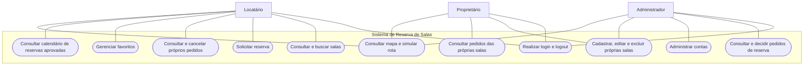
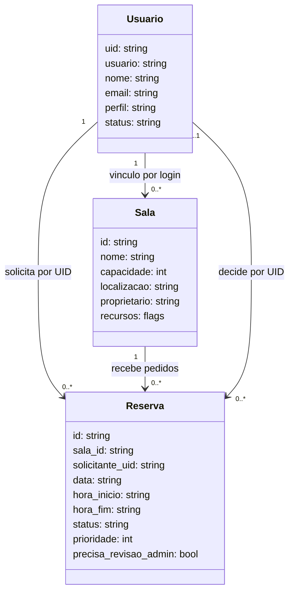
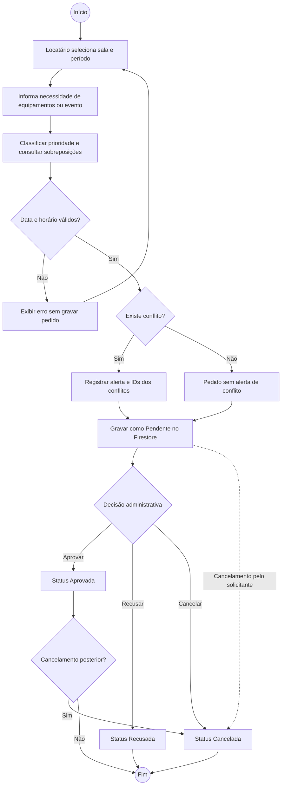
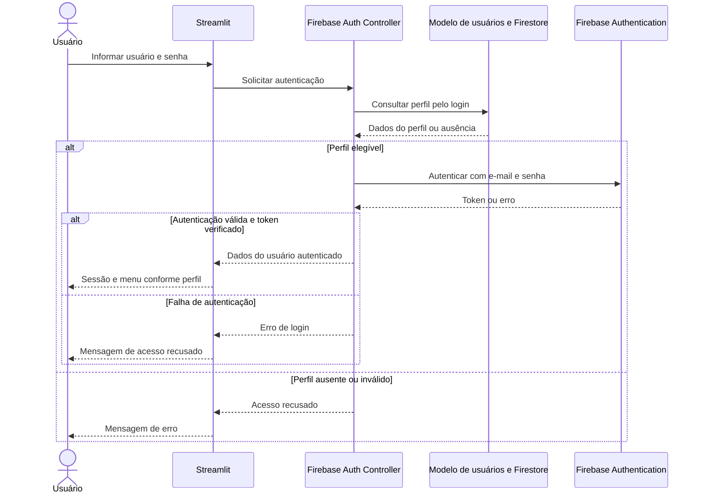
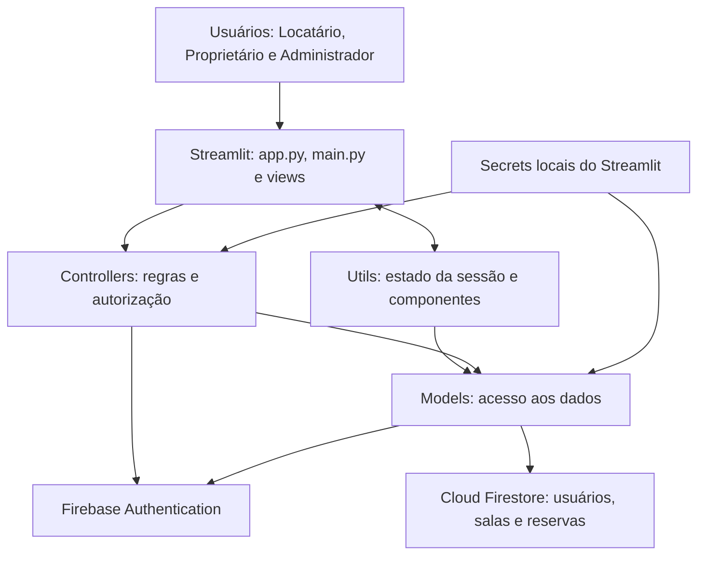

# Sistema de Reserva de Salas

Projeto acadêmico da equipe **As Branquelas**, desenvolvido na disciplina de **Engenharia de Software**, para consultar espaços, acompanhar reservas e gerenciar salas e contas.

> **2ª etapa — implementação da revisão final em 20/11/2026:** alterações desta branch partem da `main` [919feca](https://github.com/MarcosYnn/reserva_salas_asbranquelas/commit/919fecac68e74ecb7c7311a23cd524811c8987be). Foram implementadas coordenação transacional das reservas, revalidação de acesso, favoritos por UID, seleção explícita de período, filtros por recursos/localização e ajustes de navegação. A suíte local passou com **50 testes e seis subtestes**, usando as dependências reais, armazenamento simulado e testes de interface Streamlit. A validação com Firebase configurado e a homologação em celular continuam pendentes. Consulte [a implementação e seus limites](docs/implementacao-revisao-final.md).

## Problema

O gerenciamento manual de espaços dificulta a consulta de capacidade, localização, recursos e horários. A proposta busca centralizar essas informações e reduzir conflitos e duplicidades de reservas. A exclusividade na aprovação é verificada em transação, com coordenação pelo documento da sala; a validação com Firebase configurado ainda deve ser registrada.

## Público-alvo

Alunos, professores, funcionários, coordenadores e colaboradores que utilizam espaços de uma instituição.

| Perfil | Finalidade |
| --- | --- |
| Locatário | Consultar salas e acompanhar suas reservas |
| Proprietário | Cadastrar salas e acompanhar a utilização dos seus espaços |
| Administrador | Gerenciar contas, pedidos e todas as salas no painel próprio |

## Proposta de solução

Desenvolver uma aplicação web que reúna consulta de salas, filtros, reservas, favoritos, informações de perfil e administração de contas. Manutenção continua como evolução prevista; filtros por recursos e localização estão disponíveis; pedidos de reserva já possuem persistência no Firestore, e o calendário do locatário e o mapa estão integrados.

## Objetivo do MVP

Demonstrar o fluxo de acesso, consulta e reserva de salas em uma interface navegável. Na versão atual, as contas são cadastradas por um administrador; não há cadastro público na tela de login.

Fluxo do locatário: **login → Mapa do Campus → Dashboard ou Buscar Salas → solicitar reserva → Minhas Reservas → Calendário após aprovação**. O administrador acessa um painel próprio e decide os pedidos na opção Reservas.

O fluxo grava pedidos pendentes no Firestore, sujeitos à decisão administrativa. A aprovação revalida período, existência da sala e sobreposição com reservas aprovadas. As transações de criação, alteração de status e exclusão de sala coordenam o documento da sala; a concorrência foi testada com armazenamento simulado.

## Funcionalidades e situação atual

**Implementado** indica código acessível pela interface, sujeito a validação no ambiente configurado. **Parcial** indica comportamento incompleto. **Pendente** indica ausência do fluxo completo.

| Área | Situação | O que existe e quais são os limites |
| --- | --- | --- |
| Login e logout | Implementado no código | UID autenticado comparado ao UID do perfil; logout limpa navegação, filtros, favoritos e dados da conta |
| Cadastro de contas | Implementado | Administrador cadastra usuário, nome, e-mail, senha inicial, perfil e status |
| Administração de contas | Implementado | Listagem, edição, troca de senha, alteração de perfil/status e exclusão com confirmação; controles contra alteração da própria conta e remoção do último administrador ativo |
| Perfis e navegação | Implementado no código | Reconsulta status/perfil no Firestore e conta no Auth antes das ações protegidas; mudanças afetam a próxima interação |
| Salas | Parcial | Cadastro, edição e exclusão autorizada no Firestore; exclusão bloqueada quando há pedidos pendentes ou aprovados; manutenção ainda pendente |
| Busca | Implementado no código | Período válido, capacidade, localização e recursos; filtros alterados invalidam resultados anteriores; sobreposições sinalizadas para análise |
| Reservas | Implementado no código | Pedidos no Firestore por UID; duplicação ativa impedida; aprovação coordenada por sala e sem sobreposição; homologação Firebase pendente |
| Cancelamento | Implementado no código | Locatário cancela pedidos próprios com titularidade conferida na transação; administrador cancela; período volta a permitir aprovação |
| Favoritos | Implementado no código | Persistência em usuarios/{uid}/favoritos/{sala_id}; reserva exige data/início/fim no próprio formulário |
| Dashboard | Implementado no código | Próxima reserva considera apenas aprovada com início futuro; erros de carga interrompem indicadores; relógio institucional explícito |
| Perfil | Parcial | Consulta de dados; não há formulário para o usuário editar seu próprio perfil |
| Cadastro público, confirmação e recuperação de senha | Pendente no fluxo atual | Não estão expostos na tela de login; funções antigas de SMTP/hash continuam no código, mas não representam integração desses fluxos |
| Manutenção, avisos de indisponibilidade e acessibilidade das salas | Pendente | Requisitos previstos, sem fluxo completo |
| Calendário visual | Implementado no código | Locatário consulta suas reservas aprovadas por mês e abre detalhes; execução integrada e responsividade a validar |
| Mapa do Campus | Implementado no código | Disponível aos três perfis com verificação de acesso; modo desenvolvedor apenas para administrador; sem GPS real |
| Agenda, Suporte e Notificações do administrador | Fora do menu desta entrega | Atalhos provisórios removidos; não confundir com calendário do locatário |
| Responsividade | A validar | Interface e CSS existentes; validação em celular e diferentes tamanhos de tela ainda deve ser evidenciada |

## Fluxo de reservas e prioridades — main

O locatário cria um pedido com status **Pendente**. O administrador pode aprovar, recusar ou cancelar; o locatário pode cancelar seus próprios pedidos pendentes ou aprovados. O proprietário consulta pedidos vinculados às suas salas. Pedidos recusados e cancelados são estados finais.

| Prioridade | Classificação |
| --- | --- |
| 1 | Normal |
| 2 | Aula prática / necessidade de equipamentos |
| 3 | Evento institucional |

A classificação sinaliza pedidos para análise, sem substituição automática de salas ou aprovação automática. A busca considera sobreposições de pedidos pendentes e aprovados. Pedidos pendentes de pessoas diferentes podem coexistir para análise; reservas aprovadas da mesma sala/data não podem se sobrepor. A aprovação revalida conflitos e período. Criação, alteração de status e exclusão de sala leem e escrevem o documento compartilhado da sala, fazendo transações concorrentes repetirem a leitura após conflito. Essa coordenação também impede duplicação ativa do mesmo usuário/período e criação concorrente com exclusão da sala. Escritas manuais ou versões antigas do sistema que ignorem esse protocolo não estão cobertas.

## Mapa do Campus — integrado à main

O mapa utiliza seleção manual de origem e destino, grafo de corredores e acessos, algoritmo de Dijkstra, rota azul pontilhada, movimentação simulada, barra de progresso, aviso de chegada e reinício. O modo desenvolvedor é exibido apenas ao administrador.

O PR #10 está integrado; seus arquivos também constam na base final do PR #13. Arquivos: `controllers/mapa_controller.py`, `views/mapa_campus_view.py` e `views/assets/mapa_campus.png`. A dependência `Pillow` está explicitamente listada em `requirements.txt`, com versão fixada.

| Perfil | Exposição no código integrado |
| --- | --- |
| Locatário | Opção “Mapa do Campus” em `PAGINAS_LOCATARIO` |
| Administrador | Opção “Mapa” no painel administrativo |
| Proprietário | Opção “Mapa do Campus” adicionada ao menu |

Não utiliza GPS real nem certifica acessibilidade física das rotas. Validar os trajetos com os caminhos reais do campus. O mapa agora possui verificação explícita de autenticação/perfil e opção no menu do proprietário. Os três perfis ainda devem ser homologados no ambiente Firebase configurado.

Há relato anterior de teste local do autor. Não há evidência de teste integrado do mapa nesta revisão.

## Levantamento de requisitos

Os identificadores abaixo preservam o levantamento anterior para manter a rastreabilidade dos cards. São **requisitos e critérios desejados**, não uma declaração de que todos estejam atendidos. O estado da implementação está na tabela acima e nas pendências da revisão.

## Requisitos funcionais

| Código | Requisito | Situação no código |
| --- | --- | --- |
| RF01 | O sistema deve permitir o cadastro de usuários. | Cadastro pelo administrador |
| RF02 | O sistema deve permitir que o usuário realize login utilizando suas credenciais. | Implementado |
| RF03 | O sistema deve apresentar um Dashboard após o acesso do usuário. | Implementado no código: indicadores reais e próxima reserva aprovada futura; homologação pendente |
| RF04 | O sistema deve permitir consultar as salas cadastradas. | Implementado |
| RF05 | O sistema deve apresentar informações sobre cada sala, como nome, capacidade, localização e recursos disponíveis. | Implementado |
| RF06 | O sistema deve informar a situação atual de cada sala. | Pendente |
| RF07 | O sistema deve permitir consultar a disponibilidade de uma sala. | Implementado no código: sobreposição sinalizada; exclusividade conferida ao aprovar |
| RF08 | O sistema deve permitir selecionar uma sala para reserva. | Implementado: pedido no Firestore |
| RF09 | O sistema deve permitir selecionar a data da reserva. | Implementado na busca |
| RF10 | O sistema deve permitir selecionar o horário inicial e final da reserva. | Implementado: validação de período e data futura no modelo |
| RF11 | O sistema deve permitir informar a finalidade da reserva quando necessário. | Pendente |
| RF12 | O sistema deve permitir confirmar uma reserva. | Implementado no código: decisão administrativa com revalidação transacional |
| RF13 | O sistema deve registrar as reservas realizadas. | Implementado: Firestore |
| RF14 | O sistema deve permitir que o usuário consulte suas reservas. | Implementado: filtro por UID do locatário |
| RF15 | O sistema deve apresentar sala, data, horário e status das reservas realizadas. | Implementado: dados do Firestore |
| RF16 | O sistema deve permitir cancelar uma reserva quando permitido. | Implementado: cancelamento autorizado |
| RF17 | O sistema deve liberar novamente o horário após o cancelamento de uma reserva. | Implementado na lógica de busca: canceladas não ocupam horário |
| RF18 | O sistema deve impedir reservas conflitantes para uma mesma sala e período. | Implementado no código: aprovadas não se sobrepõem; pendentes podem coexistir para análise |
| RF19 | O sistema deve permitir buscar salas por características, como capacidade, localização e recursos disponíveis. | Implementado no código: capacidade, período, localização e recursos |
| RF20 | O sistema deve permitir utilizar filtros para facilitar a localização de salas. | Implementado no código: filtros invalidam resultados antigos |
| RF21 | O sistema deve permitir filtrar salas pela quantidade de pessoas. | Implementado |
| RF22 | O sistema deve permitir identificar equipamentos e recursos existentes em cada sala. | Implementado |
| RF23 | O sistema deve apresentar avisos sobre salas temporariamente indisponíveis. | Pendente |
| RF24 | O sistema deve apresentar avisos sobre salas que estejam em manutenção. | Pendente |
| RF25 | O sistema deve possuir uma área administrativa destinada a usuários autorizados. | Implementado |
| RF26 | O sistema deve permitir o cadastro de salas. | Implementado |
| RF27 | O sistema deve permitir a atualização das informações das salas. | Implementado: edição autorizada |
| RF28 | O sistema deve permitir alterar a disponibilidade das salas. | Pendente |
| RF29 | O sistema deve permitir informar períodos de manutenção. | Pendente |
| RF30 | O administrador deve poder consultar informações do sistema. | Implementado no código: painel, contas, pedidos e gestão global de salas |
| RF31 | O sistema deve apresentar informações claras sobre os recursos disponíveis em cada sala. | Implementado |
| RF32 | O sistema deve utilizar indicadores visuais para representar características das salas. | Parcial |
| RF33 | O sistema deve apresentar informações relacionadas aos recursos de acessibilidade disponíveis. | Pendente |
| RF34 | O usuário deve poder favoritar salas. | Implementado no código: favoritos persistidos por UID |
| RF35 | O sistema deve permitir recuperação e redefinição de senha. | Pendente no fluxo atual |
| RF36 | O administrador deve poder gerenciar as contas cadastradas. | Implementado |
| RF37 | O administrador deve poder bloquear e reativar contas. | Implementado no código: revalidação da próxima ação de sessão aberta |
| RF38 | O administrador deve poder alterar o tipo de conta de um usuário. | Implementado no código: revalidação da próxima ação de sessão aberta |
| RF39 | Permitir selecionar origem e destino no mapa do campus. | Implementado no código: opção e verificação de acesso para os três perfis |
| RF40 | Calcular e visualizar uma rota entre locais cadastrados. | Implementado no código integrado; trajetos reais a validar |
| RF41 | Simular movimentação, progresso e chegada ao destino. | Implementado no código integrado; teste de interface a executar |

## Requisitos não funcionais

| Código | Requisito |
| ------ | -------------------------------------------------------------------------------------------------------------- |
| RNF01 | A interface deve ser simples, clara e intuitiva. |
| RNF02 | A navegação deve manter uma identidade visual consistente. |
| RNF03 | A aplicação deve possuir interface responsiva. |
| RNF04 | O sistema deve funcionar adequadamente em diferentes tamanhos de tela. |
| RNF05 | As principais funcionalidades devem permanecer acessíveis em dispositivos móveis. |
| RNF06 | As informações devem estar organizadas para que o usuário localize rapidamente as funcionalidades necessárias. |
| RNF07 | O sistema deve apresentar mensagens claras durante as operações. |
| RNF08 | Os botões e elementos interativos devem apresentar respostas visuais às ações do usuário. |
| RNF09 | A interface deve informar claramente quando uma operação for concluída ou apresentar erro. |
| RNF10 | O acesso às funcionalidades administrativas deve ser restrito a usuários autorizados. |
| RNF11 | O sistema deve evitar conflitos e duplicidades de reservas. |
| RNF12 | A interface deve utilizar elementos visuais consistentes, como cores, ícones, botões, cards e formulários. |
| RNF13 | As informações sobre disponibilidade e indisponibilidade devem ser apresentadas de maneira clara. |
| RNF14 | Os elementos da interface devem possuir tamanho, organização e espaçamento adequados. |
| RNF15 | O projeto deve utilizar Git e GitHub para controle de versão e colaboração. |
| RNF16 | As funcionalidades desenvolvidas devem seguir os requisitos e o design definidos pela equipe. |
| RNF17 | As senhas não devem ser armazenadas em texto puro. |
| RNF18 | Credenciais externas e configurações sensíveis devem ser armazenadas por meio de variáveis de ambiente. |

## Regras de negócio

| Código | Regra |
| ------ | ------------------------------------------------------------------------------------------------------ |
| RN01 | Somente usuários cadastrados podem realizar login. |
| RN02 | O usuário deve estar autenticado para acessar as funcionalidades internas do sistema. |
| RN03 | Toda reserva deve estar associada a uma sala. |
| RN04 | Toda reserva deve possuir uma data definida. |
| RN05 | Toda reserva deve possuir horário inicial e horário final. |
| RN06 | O horário final deve ser posterior ao horário inicial. |
| RN07 | Uma sala não pode possuir duas reservas em períodos conflitantes. |
| RN08 | Uma reserva somente pode ser confirmada quando a sala estiver disponível no período escolhido. |
| RN09 | O usuário deve consultar a disponibilidade antes da confirmação da reserva. |
| RN10 | Quando uma reserva for cancelada, o horário correspondente deve voltar a ficar disponível. |
| RN11 | Salas em manutenção devem ser apresentadas como indisponíveis para reserva. |
| RN12 | Salas marcadas como indisponíveis não podem receber novas reservas no período informado. |
| RN13 | Apenas usuários autorizados podem acessar a área administrativa. |
| RN14 | Usuários autorizados poderão cadastrar e atualizar informações relacionadas às salas. |
| RN15 | O sistema deve manter as informações de disponibilidade atualizadas após cada reserva ou cancelamento. |
| RN16 | O usuário deve visualizar as características da sala antes de concluir uma reserva. |
| RN17 | O nome de usuário e o e-mail não podem ser duplicados. |
| RN18 | A conta precisa estar ativa para permitir o login. |
| RN19 | O usuário deverá confirmar o e-mail antes de acessar a conta quando a confirmação estiver habilitada. |
| RN20 | Cada tipo de conta deve visualizar apenas as funcionalidades permitidas para seu perfil. |

## Histórias de usuário

### HU01 — Cadastro

Como usuário, quero criar uma conta para acessar as funcionalidades privadas da plataforma.

### HU02 — Login

Como usuário, quero acessar o sistema utilizando minhas credenciais para utilizar suas funcionalidades.

### HU03 — Consulta de salas

Como usuário, quero visualizar as salas cadastradas para escolher o espaço mais adequado.

### HU04 — Busca por características

Como usuário, quero pesquisar salas por capacidade, localização e recursos para encontrar rapidamente uma opção adequada.

### HU05 — Filtros de busca

Como usuário, quero utilizar filtros para visualizar apenas as salas que atendem às minhas necessidades.

### HU06 — Recursos da sala

Como usuário, quero visualizar os recursos existentes em cada sala para saber se o ambiente é adequado à atividade que pretendo realizar.

### HU07 — Consulta de disponibilidade

Como usuário, quero consultar os horários disponíveis de uma sala para saber quando ela poderá ser utilizada.

### HU08 — Reserva de sala

Como usuário, quero selecionar uma sala, uma data e um horário para realizar uma reserva.

### HU09 — Acompanhamento

Como usuário, quero visualizar minhas reservas para acompanhar os espaços e horários reservados.

### HU10 — Cancelamento

Como usuário, quero cancelar uma reserva quando não precisar mais utilizar a sala.

### HU11 — Favoritos

Como usuário, quero favoritar salas que utilizo com frequência para encontrá-las com maior facilidade.

### HU12 — Avisos

Como usuário, quero visualizar avisos sobre salas indisponíveis ou em manutenção.

### HU13 — Acessibilidade

Como usuário, quero visualizar informações sobre recursos de acessibilidade para saber se o espaço atende às minhas necessidades.

### HU14 — Gerenciamento de salas

Como Proprietário, quero cadastrar e visualizar minhas salas para acompanhar os espaços disponibilizados.

### HU15 — Administração

Como Administrador, quero gerenciar as contas cadastradas para controlar o acesso à plataforma.

### HU16 — Recuperação de senha

Como usuário, quero recuperar minha senha por meio do meu e-mail para voltar a acessar minha conta.

### HU17 — Mapa do Campus

Como usuário, quero selecionar minha origem e destino para visualizar um caminho dentro do campus.

## Critérios gerais de aceitação

* Os campos obrigatórios devem ser validados;
* Dados inválidos devem apresentar mensagens claras;
* Usuários sem autenticação não devem acessar áreas internas;
* O usuário deve conseguir visualizar as salas cadastradas;
* Cada sala deve apresentar suas principais características;
* O sistema deve permitir pesquisar e filtrar salas;
* Os filtros devem alterar os resultados de acordo com os critérios informados;
* O sistema deve informar quando uma sala estiver disponível;
* O sistema deve informar quando uma sala estiver indisponível;
* O usuário deve conseguir consultar a disponibilidade antes de reservar;
* O sistema não deve permitir reservas conflitantes;
* Uma reserva confirmada deve aparecer na área de reservas;
* O cancelamento deve atualizar a situação da reserva;
* Após o cancelamento, o horário deve voltar a ficar disponível;
* A área administrativa deve ser acessível somente por usuários autorizados;
* Mensagens de erro e sucesso devem ser apresentadas de forma clara;
* O sistema deve diferenciar permissões de Locatários, Proprietários e Administradores;
* Usuários bloqueados não devem conseguir acessar o sistema;
* O sistema deve impedir a duplicidade de e-mails e nomes de usuário;
* As senhas cadastradas devem atender aos critérios mínimos de segurança.

## Diagramas UML

Os diagramas representam a base integrada indicada no início do documento. O caso de uso e o diagrama de atividades utilizam a sintaxe de fluxograma Mermaid como aproximação visual da UML; o diagrama de classes é conceitual, pois a implementação Python é organizada principalmente em funções e módulos. O mapa e o calendário já pertencem à base integrada; os limites de acesso por perfil são descritos nas respectivas seções.

### Diagrama de caso de uso

O administrador acessa um painel próprio e gerencia todas as salas, enquanto o proprietário continua limitado às suas. O painel não expõe o formulário de nova sala existente no dashboard do proprietário. O mapa está exposto aos três perfis.

### Diagrama de classes — modelo conceitual

As relações representam vínculos lógicos entre documentos, não chaves estrangeiras impostas pelo Firestore. Salas excluídas podem possuir registros históricos. Os favoritos são persistidos na subcoleção usuarios/{uid}/favoritos; o conjunto na sessão é apenas uma cópia para renderização.

### Diagrama de atividades — processo de reserva

A aprovação não é automática por prioridade. O código registra conflitos e, ao aprovar, revalida a disponibilidade em uma transação coordenada com as demais alterações da sala.

### Diagrama de sequência — login

Após o login, o servidor reconsulta perfil/status e conta Auth nas próximas interações protegidas. Isso não é uma conexão de atualização em tempo real de páginas inativas.

## Tecnologias utilizadas

| Tecnologia | Utilização |
| --- | --- |
| Python e Streamlit | Lógica da aplicação, interface, navegação e estado da sessão |
| Firebase Authentication | Contas, autenticação e armazenamento das credenciais |
| Cloud Firestore | Persistência de usuários, salas e pedidos de reserva |
| Firebase Admin SDK | Operações de contas e acesso ao Firestore pelo servidor |
| Requests | Chamada ao endpoint de login do Firebase |
| Python-dotenv | Carregamento opcional de variáveis; não substitui os secrets exigidos pelo Firebase |
| Pillow | Leitura da imagem e desenho das rotas do mapa |
| CSS e HTML | Estilização e componentes visuais |
| Git e GitHub | Versionamento, revisão e integração |
| PraxiLab | Kanban, responsáveis, evidências e entrega acadêmica |

SQLite foi removido do fluxo atual no PR #7. As funções de hash PBKDF2 e SMTP em `controllers/auth_controller.py` são remanescentes; o login atual utiliza Firebase Authentication. Não há modo offline funcional sem configuração do Firebase.

As dependências diretas estão fixadas em `requirements.txt`. Ambiente validado: Python 3.12. Use `requirements-dev.txt` para instalar também pytest. A automação de testes está em `.github/workflows/tests.yml`; a execução remota deve ser conferida no PR.

## Arquitetura do projeto

A organização é inspirada em MVC, com parte das páginas ainda concentrada em `main.py`.

| Caminho | Responsabilidade atual |
| --- | --- |
| `app.py` | Configuração, inicialização, verificação de sessão e menu |
| `main.py` | Páginas de locatário, proprietário e administrador |
| `controllers/firebase_auth_controller.py` | Login no Firebase e verificação do token |
| `controllers/usuario_firebase_controller.py` | Validação e autorização das operações administrativas |
| `controllers/autorizacao_controller.py` | Restrições por perfil nas páginas |
| `controllers/auth_controller.py` | Validações reutilizadas e funções legadas de hash/SMTP |
| `models/firebase_client.py` | Inicialização do Admin SDK a partir dos secrets |
| `models/usuario_firebase_model.py` | Contas Auth e documentos da coleção `usuarios` |
| `models/sala_firebase_model.py` | Cadastro, listagem, exclusão e dados demonstrativos de salas |
| `utils/estado.py` | Adaptação de dados, salas e funções legadas; limpeza da conta delegada a utils/sessao.py |
| `utils/sessao.py` | Limpeza de estado associado à conta |
| `controllers/sessao_controller.py` | Revalidação de conta Auth e perfil do Firestore |
| `models/favorito_firebase_model.py` | Favoritos persistidos por UID |
| `controllers/favorito_controller.py` | Autorização das operações de favoritos |
| `utils/busca.py` | Invalidação de resultados e período quando filtros mudam |
| `utils/relogio.py` | Fuso institucional configurável com APP_TIMEZONE |
| `utils/componentes.py` | CSS, cards, listas e ações da interface |
| `views/login_view.py` | Tela de login |
| `views/admin_view.py` | Painel, navegação administrativa e indicadores |
| `views/admin_cadastro_figma.py` | Formulário de cadastro de contas |
| `views/admin_usuarios_firebase.py` | Listagem e gerenciamento das contas |
| `assets/` | Imagens utilizadas pela interface |

`views/locatario_view.py` e `views/proprietario_view.py` estão vazios. Não há `models/database.py` nem script de criação de administrador no estado atual. A existência de pastas não significa que todas as responsabilidades já estejam separadas.

Módulos adicionados à main:

| Caminho | Responsabilidade |
| --- | --- |
| `controllers/reserva_controller.py` | Prioridade, conflitos, pedidos e permissões |
| `controllers/sala_controller.py` | Edição e exclusão autorizada de salas |
| `models/reserva_firebase_model.py` | Persistência, validação e transições de status |
| `views/reserva_view.py` | Listagem e ações por perfil |
| `tests/test_validacao_datas_reservas.py` | Testes unitários de datas e horários |
| `docs/validacao-datas-reservas.md` | Roteiro e critérios de regressão |
| `views/calendario_locatario_view.py` | Calendário mensal das reservas aprovadas do locatário |
| `controllers/mapa_controller.py` | Grafo, cálculo de rotas e movimentação simulada |
| `views/mapa_campus_view.py` | Interface e desenho do mapa |
| `views/assets/mapa_campus.png` | Imagem base do campus |

### Representação visual da arquitetura

O diagrama simplifica a arquitetura inspirada em MVC: existem acessos diretos a modelos e utilitários em algumas páginas. Favoritos e pedidos são persistidos no Firestore; a sessão mantém uma cópia dos favoritos e o estado de navegação. O mapa, sua imagem e o controller de rotas já estão integrados à main. O calendário também está disponível no menu do locatário.

## Banco de dados e armazenamento

| Informação | Onde fica | Campos e limites |
| --- | --- | --- |
| Credenciais | Firebase Authentication | UID, e-mail, senha e situação da conta; senha não é gravada no documento do Firestore |
| Perfis | `usuarios/{uid}` no Firestore | `usuario`, `nome`, `email`, `perfil`, `status`; ID do documento deve corresponder ao UID Auth |
| Salas | `salas/{id}` no Firestore | `id`, `nome`, `capacidade`, `localizacao`, `proprietario` e flags de recursos |
| Reservas | `reservas/{id}` no Firestore | `sala_id`, `sala_nome`, `solicitante_uid`, `solicitante_nome`, `proprietario_login`, `data`, `hora_inicio`, `hora_fim`, `status`, prioridade, flags de conflito e timestamps |
| Favoritos | `usuarios/{uid}/favoritos/{sala_id}` no Firestore | IDs de salas persistidos por conta; sessão mantém cópia para a interface |

As salas permitem projetor, computador, internet, webcam, quadro e ar-condicionado. Novas salas recebem ID gerado por UUID; as demonstrativas usam IDs numéricos.

A inicialização grava quatro salas de demonstração se a coleção `salas` estiver vazia. Também recria reservas demonstrativas na sessão para as salas cujos IDs forem encontrados. Esses dados não são agendamentos reais.

Os pedidos atuais são vinculados ao UID do solicitante e ao ID da sala. O vínculo do proprietário ainda depende do login; a mudança de login exige atenção. As reservas demonstrativas na sessão são legadas e não representam os pedidos persistidos.

Não há migração automática de contas ou salas de antigos bancos SQLite. Os dados já existentes no projeto Firebase precisam ser conferidos antes de qualquer alteração.

## Autenticação, perfis e permissões

O login recebe **nome de usuário e senha**. O servidor procura o perfil no Firestore, obtém o e-mail associado, solicita autenticação ao Firebase e verifica o token retornado.

- Usuário: de 3 a 30 caracteres, normalizado em minúsculas, com letras sem acento, números, ponto, hífen ou sublinhado.
- Senha nos formulários administrativos: pelo menos oito caracteres, com maiúscula, minúscula e número.
- Perfis aceitos: `Locatário`, `Proprietário` e `Administrador`.
- Status aceitos: `ativo` e `inativo`.

Para perfis antigos sem `usuario`, o modelo usa temporariamente a parte do e-mail anterior ao `@`. Se houver mais de um perfil com o mesmo login, a busca não escolhe um deles. O administrador deve revisar esses perfis e cadastrar logins explícitos e distintos.

| Perfil | Páginas disponíveis |
| --- | --- |
| Locatário | Mapa do Campus, Dashboard, Buscar Salas, Minhas Reservas, Calendário, Favoritos e Perfil |
| Proprietário | Mapa do Campus, Dashboard, Minhas Salas, Pedidos de Reserva e Perfil |
| Administrador | Painel próprio com Início, Salas, Mapa, Reservas e Administração; atalhos provisórios removidos |

O painel administrativo reutiliza a página de salas, mostrando todas as salas ao administrador. Proprietários continuam limitados às salas vinculadas ao seu login. O cadastro de nova sala continua no dashboard do proprietário.

As operações administrativas verificam o perfil recebido, bloqueiam alteração/exclusão da própria conta e buscam preservar o último administrador ativo. UID do perfil e UID autenticado são comparados no login e na revalidação. Perfil/status e conta Auth são reconsultados nas ações protegidas. A proteção do último administrador ativo ainda requer revisão de concorrência. O uso do Admin SDK exige que as verificações de autorização sejam mantidas no servidor.

A tela atual não oferece cadastro público, confirmação de e-mail nem recuperação de senha pelo usuário. O administrador pode definir uma nova senha pelo painel; isso não é um fluxo de recuperação por e-mail.

## Segurança do sistema

| Mecanismo | Implementação e limites |
| --- | --- |
| Autenticação | Firebase Authentication valida as credenciais; o servidor verifica o token retornado. |
| Controle de acesso | Menus por perfil e verificações nos controllers restringem operações; esconder opções na interface não substitui autorização no servidor. |
| Proteção de credenciais | Configuração sensível em `.streamlit/secrets.toml`, fora do versionamento; no ambiente publicado, utilizar o gerenciador de secrets. Não compartilhar chaves privadas em commits ou evidências. |
| Separação de dados | Credenciais no Firebase Authentication; perfil no Firestore associado ao UID, sem senha no documento. |
| Permissões no servidor | Controllers verificam perfil, titularidade dos pedidos e vínculo das salas. O Admin SDK exige cuidado especial, pois opera com permissões da conta de serviço. |
| Administração | Restrições à alteração e exclusão da própria conta e à remoção do último administrador ativo. |

Vínculo do UID e revalidação de status/perfil foram implementados. As reservas agora coordenam criação, aprovação, cancelamento e exclusão da sala por transação. Permanecem necessárias a homologação com Firebase, a revisão dos privilégios da conta de serviço e a proteção concorrente do último administrador. Não foi realizada auditoria de segurança completa.

## Como executar o projeto

### Pré-requisitos

- Python 3.12 e Git instalados.
- Um projeto Firebase destinado aos testes, com Authentication e Cloud Firestore configurados.
- Provedor **E-mail/senha** habilitado no Firebase Authentication.
- Conta de serviço autorizada para as operações utilizadas pelo servidor.
- Conta administrativa inicial configurada conforme a seção seguinte.

### Preparar o ambiente

~~~bash
git clone https://github.com/MarcosYnn/reserva_salas_asbranquelas.git
cd reserva_salas_asbranquelas
~~~

No Windows/PowerShell:

~~~powershell
python -m venv .venv
.\.venv\Scripts\Activate.ps1
python -m pip install -r requirements.txt
~~~

No Linux/macOS:

~~~bash
python3 -m venv .venv
source .venv/bin/activate
python -m pip install -r requirements.txt
~~~

### Configurar Firebase e Streamlit

Crie localmente `.streamlit/secrets.toml` com a estrutura abaixo. Os valores são exemplos: substitua `service_account_json` pelo JSON completo da conta de serviço, preservando os escapes `\n` da chave privada.

~~~toml
[firebase]
project_id = "SEU_PROJECT_ID"
web_api_key = "SUA_WEB_API_KEY"
service_account_json = '''
{
  "type": "service_account",
  "project_id": "SEU_PROJECT_ID",
  "private_key_id": "SUBSTITUIR",
  "private_key": "SUBSTITUIR_PELO_VALOR_DO_JSON",
  "client_email": "SUBSTITUIR",
  "client_id": "SUBSTITUIR",
  "auth_uri": "https://accounts.google.com/o/oauth2/auth",
  "token_uri": "https://oauth2.googleapis.com/token"
}
'''
~~~

`project_id`, a conta de serviço e a Web API Key devem pertencer ao mesmo projeto. O cliente verifica a igualdade entre o Project ID configurado e o JSON da conta de serviço.

No Streamlit Community Cloud, configure o mesmo conteúdo no campo de secrets da aplicação. O arquivo real está no `.gitignore` e não deve ser anexado a cards, commits, capturas ou relatórios.

O repositório não fornece `.env.example` nem `secrets.toml` preenchido. Variáveis SMTP do código antigo não são necessárias para o login Firebase atual.

### Preparar o primeiro administrador

Não existe criação automática de administrador nem senha padrão no código atual.

Um responsável com acesso autorizado ao projeto Firebase deve:

1. Criar uma conta de teste no Firebase Authentication com e-mail e senha.
2. Copiar seu UID.
3. Criar no Firestore um documento em `usuarios` com **esse mesmo UID** como ID.
4. Preencher os campos abaixo, usando o mesmo e-mail da conta Auth.

~~~json
{
  "usuario": "admin_teste",
  "nome": "Administrador de Teste",
  "email": "EMAIL_DA_CONTA_AUTH",
  "perfil": "Administrador",
  "status": "ativo"
}
~~~

Depois, entre com o login configurado em `usuario` e a senha da conta Auth. As demais contas podem ser cadastradas no painel administrativo. Não basta criar somente o usuário Auth ou somente o documento do Firestore.

### Fuso institucional

O padrão é `America/Porto_Velho`. Para outra instituição, configure a variável de ambiente `APP_TIMEZONE` com um identificador IANA válido. A aplicação utiliza o mesmo relógio para validar períodos, exibir datas e calcular a próxima reserva.

### Iniciar a aplicação

~~~bash
python -m streamlit run app.py
~~~

Acesse o endereço exibido no terminal, normalmente `http://localhost:8501`.

| Problema | Verificação inicial |
| --- | --- |
| Secrets não encontrados | Conferir caminho local ou configuração de secrets no Streamlit Cloud |
| Project ID divergente | Conferir o projeto informado e o JSON da conta de serviço |
| Login recusado | Conferir login, e-mail correspondente no Auth, senha, status e perfil |
| Perfil antigo não localizado | Revisar o campo `usuario` e possíveis logins repetidos |
| Erro de acesso ao Firestore | Conferir credenciais e permissões do projeto de teste |
| Salas de exemplo inesperadas | A inicialização preenche a coleção quando ela está vazia |

## Revisão do código — 20/11/2026

Os identificadores originais foram preservados para rastreabilidade; as situações abaixo refletem leitura de código, não aprovação dos testes.

| ID | Prioridade | Constatação e encaminhamento |
| --- | --- | --- |
| REV01 | Alta | Pedidos e favoritos persistidos por UID; testes locais de isolamento passaram; homologação Firebase pendente |
| REV02 | Alta | Aprovação sem sobreposição e coordenação por sala implementadas; disputa simultânea passou com armazenamento simulado |
| REV03 | Alta | Duplicação ativa impedida; aprovação revalida sala, data e horários canônicos; testes locais passaram |
| REV04 | Alta | Favoritos possui formulário próprio de período; filtros alterados invalidam resultados da busca |
| REV05 | Alta | Pedidos/favoritos por UID; vínculo de salas ao proprietário ainda por login, migração pendente |
| REV06 | Alta | UID conferido; conta e perfil reconsultados antes das ações; logout limpa dados associados à conta |
| REV07 | Média | Criação/aprovação de sala removida recusadas; exclusão com pedido ativo bloqueada atomicamente; históricos ainda devem ser homologados |
| REV08 | Média | Cancelamento com titularidade na transação e liberação de período; teste local aprovado |
| REV09 | Média | Próxima reserva apenas aprovada e futura; falha de carga não simula disponibilidade; fuso explícito |
| REV10 | Média | Edição global pelo admin, calendário e filtros implementados; manutenção e edição de perfil pendentes |
| REV11 | Média | 50 testes e seis subtestes locais passaram; dependências diretas fixadas, Python 3.12 e CI configurados; celular pendente |
| REV12 | Média | Mapa com controle de acesso e menu para três perfis; validar desenho das rotas e uso real no campus |

A revisão do card **“Revisão do código”** deve vincular cada correção ao card correspondente do PraxiLab e ao PR que a implementar. O calendário já está integrado; testar a atualização após aprovação e cancelamento. Agenda do administrador é uma opção distinta, ainda sem fluxo implementado.

## Testes e validação

Esta atualização documental foi baseada na leitura do código e do histórico de integração. **Não registra uma execução de ponta a ponta da aplicação publicada nem aprovação dos testes abaixo.** Esta branch contém testes de datas, transações concorrentes, permissões, favoritos e interface. A execução local passou; o resultado da CI remota deve ser conferido no PR.

Utilizar contas e projeto Firebase de teste. Os casos de regressão associados às pendências devem ser repetidos após as correções.

| Caso | Procedimento e resultado esperado | Resultado | Situação anterior / dependência | Evidência |
| --- | --- | --- | --- | --- |
| T01 | Acessar sem login: conteúdo interno e menu protegidos | Não executado | A executar | — |
| T02 | Entrar com cada perfil e verificar somente as páginas permitidas | Não executado | A executar | — |
| T03 | Tentar senha incorreta, conta inativa e perfil inválido: acesso recusado | Não executado | A executar | — |
| T04 | Administrador criar, editar e excluir conta de teste; conferir Auth e Firestore | Não executado | A executar | — |
| T05 | Tentar alterar a própria conta e remover o último admin ativo: operação recusada | Não executado | A executar | — |
| T06 | Cadastrar sala, abrir nova sessão e conferir persistência e vínculo do proprietário | Não executado | A executar | — |
| T07 | Reservar e abrir outra sessão: mesma reserva e bloqueio devem estar disponíveis | Não executado | A executar: persistência implementada | — |
| T08 | Reservar 9h–11h e tentar 10h–12h, repetir clique e disputar horário em duas sessões | Não executado | Regressão de REV02/REV03 | — |
| T09 | Tentar término anterior/igual ao início e data passada: impedir reserva | Não executado | Regressão de REV03 | — |
| T10 | Reservar a partir de Favoritos sem busca anterior: exigir período válido | Não executado | Regressão de REV04 | — |
| T11 | Cancelar a própria reserva e consultar novamente a disponibilidade | Não executado | A executar: cancelamento implementado | — |
| T12 | Usar contas de nomes iguais e alternar login/logout: dados devem ficar isolados | Não executado | Regressão de REV01/REV05 | — |
| T13 | Exibir reserva de sala removida: tratar ausência sem interromper a página | Não executado | Regressão de REV07 | — |
| T14 | Bloquear ou alterar perfil de conta já conectada e verificar restrição de acesso | Não executado | Regressão de REV06 | — |
| T15 | Conferir layout, contraste e operações em computador e celular | Não executado | A executar | — |
| T16 | Mapa: selecionar origem/destino, conferir rota por corredores, simular chegada e reiniciar | Não executado | Código integrado: regressão pendente | Relato de teste local anterior à integração; sem registro formal anexado. Repetir na versão integrada. |
| T17 | Mapa: testar os três perfis e validar grafo | Não executado | Opções e controle de acesso implementados | — |
| T18 | Aprovar dois pedidos sobrepostos e testar concorrência | Não executado no Firebase | Passou com armazenamento MVCC simulado; repetir no ambiente configurado | tests/test_transacoes_reservas.py |

**Resultado:** Aprovado, Reprovado ou Não executado. A coluna de evidência deve receber o link ou registro real da execução, sem credenciais ou dados pessoais. Os 18 casos ainda não possuem execução formal comprovada nesta revisão; o relato do mapa não equivale à aprovação do teste integrado.

Para executar os testes de datas (sem operações Firestore):

~~~bash
python -m unittest discover -s tests -p "test_validacao_datas_reservas.py" -v
~~~

A regra utiliza o fuso institucional definido por `APP_TIMEZONE`, com padrão `America/Porto_Velho`. Consulte [o roteiro de validação](docs/validacao-datas-reservas.md). A suíte desta branch passou com 50 testes e seis subtestes, importando o SDK real e usando seu decorator transacional real sobre armazenamento MVCC simulado; os testes de interface usam AppTest do Streamlit. O armazenamento simulado exercita conflito de versões, repetição de transações e rollback; não certifica comportamento do serviço remoto. Os testes T01–T18 ainda precisam de homologação com Firebase.

Para executar toda a suíte, sem secrets:

~~~bash
python -m pip install -r requirements-dev.txt
python -m pytest -q
~~~

Cada execução deve registrar data, responsável, ambiente, passos, resultado observado, evidência e eventual card de erro. Não marcar teste como aprovado apenas porque existe código para a funcionalidade.

## Organização do projeto e critérios da 2ª etapa

A equipe utiliza o Kanban do PraxiLab: **Backlog → A Fazer → Em Andamento → Revisão → Concluído**.

Conforme a orientação do professor:

- Cada integrante deve criar ou assumir suas próprias tarefas, atualizar seu andamento e evidenciar autonomia.
- Todos devem contribuir efetivamente com codificação em branch própria e ter **pelo menos 10 commits relevantes por integrante na etapa**.
- Toda contribuição no código deve estar vinculada a um card do PraxiLab.
- O líder realiza a entrega final na plataforma com o relatório do projeto e das contribuições de cada integrante.
- A avaliação é individual e considera as evidências reais de participação.

O professor também informou que a remoção por falta de participação depende de avaliação docente, impede ingresso em outra equipe nesta etapa e pode resultar em reprovação conforme os critérios da disciplina.

### Fluxo de contribuição

1. Registrar no card objetivo, responsável, prioridade, prazo, critérios de aceitação e dependências.
2. Atualizar a base e criar branch própria, como `feature/arthur-reservas` ou `docs/arthur-readme`.
3. Desenvolver e produzir commits que representem mudanças relevantes.
4. Referenciar o identificador real do card nas mensagens e no PR. Não inventar IDs.
5. Testar o comportamento alterado e registrar o resultado.
6. Atualizar a documentação afetada na própria PR; cada integrante documenta sua alteração.
7. Abrir PR, solicitar revisão de outro integrante e anexar os links ao card.
8. Mover para Concluído após revisão, integração e registro das evidências.

Revisões e documentação são contribuições úteis, mas não substituem a exigência de codificação. O mínimo de commits é por integrante na etapa, não por card; o total não deve ser alcançado por alterações artificiais. Este README não certifica que alguém já cumpriu a quantidade exigida.

### Registro para o relatório final

| Campo | O que registrar |
| --- | --- |
| Integrante | Nome e conta GitHub |
| Card | Identificador, título e link real no PraxiLab |
| Contribuição | Problema, implementação e resultado obtido |
| GitHub | Branch, commits, PR e integração |
| Validação | Testes executados, resultados e evidências |
| Documentação | Seções atualizadas |
| Pendências | Limites e dependências ainda não concluídos |

O card **“Revisão do código”** tem a revisão registrada nesta documentação; as correções continuam pendentes até serem implementadas e validadas. O estado do quadro PraxiLab deve ser atualizado pelos responsáveis.

## Integrantes e contribuições registradas

As responsabilidades abaixo preservam o registro anterior da equipe. As evidências específicas devem ser complementadas pelos integrantes nos cards e no relatório final; responsabilidade atribuída não comprova, por si só, autoria de todos os módulos.

| Integrante | Papel | Participação registrada |
| --- | --- | --- |
| Alexandre Amorim | Scrum Master | Organização e acompanhamento da equipe; participação registrada em autenticação, revisão, ajustes de banco e login; histórico também contém correções de caracteres, painel e usabilidade |
| Arthur Coelho | Documentação e requisitos | Organização do README, requisitos, regras e critérios; histórico de atualizações documentais; revisão das pendências e preparação desta atualização, sujeita a revisão e integração |
| Emerson Castro | Back-end | Participação registrada na estrutura MVC, dashboard, autenticação e ajustes técnicos; histórico contém alterações em `app.py`, `main.py`, estado e login |
| Giullia Di Fátima | Front-end e Design | Design e organização da interface; histórico contém ajustes de layout, textos, imagens e tela de login |
| João Carlos Neres | Levantamento de requisitos e integração Firebase | Necessidades dos usuários; histórico e PRs #6 e #7 registram CRUD de contas, integração Firebase e migração de login e salas |
| Marcos Yan | Back-end | Participação registrada em desenvolvimento, integração Streamlit/GitHub, testes de funcionalidade, estrutura MVC, dashboard e autenticação; vincular evidências específicas no relatório |
| Paulo Nathan | Design | Criação visual e organização das telas; desenvolvimento do Mapa do Campus, grafo, Dijkstra e navegação simulada no PR #10, já integrado; resolução de conflitos com a main. |

### Evidências disponíveis no GitHub

- [Histórico do README](https://github.com/MarcosYnn/reserva_salas_asbranquelas/commits/main/README.md): atualizações anteriores de Arthur (`Art455hur`).
- [PR #2 — Tela de cadastro](https://github.com/MarcosYnn/reserva_salas_asbranquelas/pull/2): entrega histórica integrada; não comprova existência do cadastro público na interface atual.
- [PR #4 — Mudança de código na tela de cadastro](https://github.com/MarcosYnn/reserva_salas_asbranquelas/pull/4): alterações históricas integradas.
- [PR #6 — Firebase e CRUD de usuários](https://github.com/MarcosYnn/reserva_salas_asbranquelas/pull/6): integração já realizada.
- [PR #7 — Migração de autenticação e correções](https://github.com/MarcosYnn/reserva_salas_asbranquelas/pull/7): integrado em 13/11/2026; login, perfis e salas com Firebase.
- [Histórico geral](https://github.com/MarcosYnn/reserva_salas_asbranquelas/commits/main/): consultar autoria e alterações antes de preencher o relatório.

Na revisão anterior, os PRs #3 e #5 estavam abertos; seus estados atuais não foram conferidos nesta atualização.

- [PR #10 — Mapa do Campus](https://github.com/MarcosYnn/reserva_salas_asbranquelas/pull/10): integrado; código presente na base final do PR #13.
- [PR #11 — Bloqueio de reservas passadas](https://github.com/MarcosYnn/reserva_salas_asbranquelas/pull/11): integrado conforme histórico da main.
- [PR #12 — Ambiente e login](https://github.com/MarcosYnn/reserva_salas_asbranquelas/pull/12): integrado.
- [PR #13 — Integração final](https://github.com/MarcosYnn/reserva_salas_asbranquelas/pull/13): integrado; base desta revisão.
- [Comparação da base anterior com a versão revisada](https://github.com/MarcosYnn/reserva_salas_asbranquelas/compare/bdab79c...919feca).
- [Código integrado do mapa](https://github.com/MarcosYnn/reserva_salas_asbranquelas/blob/919fecac68e74ecb7c7311a23cd524811c8987be/views/mapa_campus_view.py).

## Links do projeto

- [Repositório no GitHub](https://github.com/MarcosYnn/reserva_salas_asbranquelas)
- [Aplicação cadastrada no repositório](https://reservasalasasbranquelas-znumjlvbtfpn9kejpwh5dl.streamlit.app/)
- [Issues](https://github.com/MarcosYnn/reserva_salas_asbranquelas/issues)
- [Pull Requests](https://github.com/MarcosYnn/reserva_salas_asbranquelas/pulls)

O link da aplicação é o endereço registrado pelo projeto; sua disponibilidade e configuração não foram verificadas nesta revisão. O repositório não informa um link público do quadro PraxiLab ou um protótipo Figma para incluir aqui.

## Implementação da revisão final

Rastreabilidade: [issue #14 — revisão final](https://github.com/MarcosYnn/reserva_salas_asbranquelas/issues/14). Vincular também aos IDs reais do PraxiLab.

| Grupo | Entrega nesta branch | Validação local |
| --- | --- | --- |
| Reservas | Coordenação transacional por sala; aprovação revalida conflitos/período; duplo clique não duplica pedido ativo; exclusão concorrente não deixa pedido órfão | Datas e testes de transações passaram |
| Acesso | UID de perfil conferido; status, perfil e conta Auth reconsultados; dados da conta limpos no logout | Bloqueio, exclusão, rebaixamento e falha de consulta testados |
| Favoritos e busca | Favoritos persistidos por UID; formulário de período próprio; busca invalidada quando filtros mudam | Isolamento e interface testados |
| Interface | Filtros de localização/recursos; mapa nos três perfis; gestão global de salas pelo administrador; atalhos provisórios retirados | Testes automatizados parciais; homologação visual pendente |
| Ambiente | Python 3.12, dependências diretas fixadas, fuso configurável e workflow de testes | 50 testes e seis subtestes passaram localmente |

Consulte [docs/implementacao-revisao-final.md](docs/implementacao-revisao-final.md) para detalhes das transações, execução de testes e card de homologação.

## Próximos passos

1. Revisar e integrar o PR desta implementação, vinculando-o aos cards reais do PraxiLab.
2. Executar T01–T18 em projeto Firebase de teste, incluindo disputa em duas sessões independentes.
3. Homologar computador/celular e conferir mapa e calendário nos perfis correspondentes.
4. Concluir os requisitos que permanecerem no escopo: manutenção, finalidade, acessibilidade, edição de perfil e recuperação de senha.
5. Migrar o vínculo de propriedade das salas do login para UID com planejamento para dados existentes.
6. Revisar concorrência da proteção do último administrador ativo e permissões da conta de serviço.
7. Consolidar evidências individuais e relatório final; não marcar testes de serviço remoto como aprovados com base somente na suíte local.
